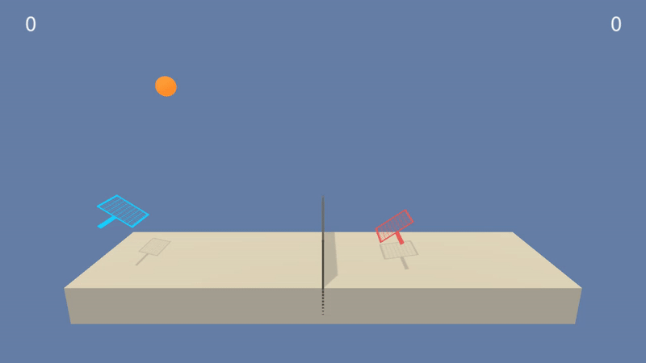
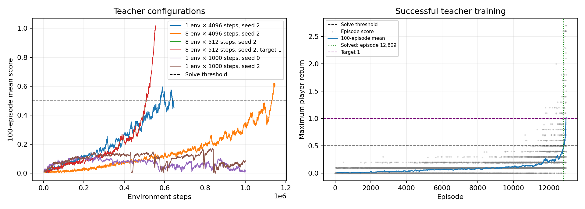
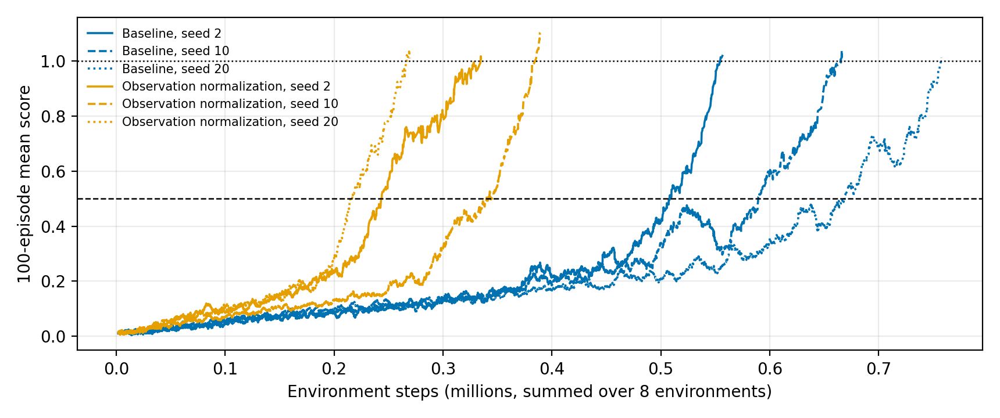

# Student Teacher PPO

This project applies policy distillation to a cooperative two-agent Tennis task.
A shared teacher policy is trained with Proximal Policy Optimization (PPO) using
both players' observations. A student policy then learns to reproduce the
teacher's actions through supervised regression using only its own observation.
Optional observation normalization halves the experience the teacher needs.
The implementation uses Python, PyTorch and the Udacity Unity Tennis environment.



The saved student controlling both players in Unity, using local observations.
The 12-second recording is illustrative; quantitative results come from separate
500-game evaluations. [Recording details](assets/student_playing.json).

## Contents

- [Getting started](#getting-started)
- [Usage](#usage)
- [Results](#results)
- [Reproducing the study](#reproducing-the-study)
- [Running tests](#running-tests)
- [Recording gameplay](#recording-gameplay)
- [Troubleshooting](#troubleshooting)
- [Project structure and report](#project-structure-and-report)
- [Acknowledgments and third-party licenses](#acknowledgments-and-third-party-licenses)

## Getting started

### Prerequisites

- Linux x86-64 and Python 3.10 with virtual-environment support.
- `git`, `curl` and `unzip`.
- For the supplied parallel reproduction configs: at least 16 logical CPUs
  available to the process. Teacher training uses eight Unity workers;
  demonstration collection uses sixteen. Worker counts can be configured.
- A graphical desktop to watch gameplay interactively. Evaluation and training
  run headlessly; recording uses `Xvfb` and `ffmpeg` instead.

The dependencies install CPU PyTorch; GPU training is not required.

### Installation

Clone the repository and install the Python dependencies:

```bash
git clone https://github.com/flsmr/multi-agent-RL.git
cd multi-agent-RL
python3.10 -m venv .venv
source .venv/bin/activate
python -m pip install -r requirements.txt
```

Download the compatible Linux Tennis executable:

```bash
mkdir -p env
curl -fL --retry 2 \
  https://s3-us-west-1.amazonaws.com/udacity-drlnd/P3/Tennis/Tennis_Linux.zip \
  -o env/Tennis_Linux.zip
unzip env/Tennis_Linux.zip -d env
chmod +x env/Tennis_Linux/Tennis.x86_64
rm env/Tennis_Linux.zip
```

Keep `Tennis_Data/` beside the executable. The Unity editor is not needed.
The compatible legacy API-4 Python client is bundled in `vendor/`.

## Usage

Evaluate the supplied student without retraining:

```bash
python evaluate.py --checkpoint runs/student_distill_target1_seed0/best.pt \
  --episodes 100 --output-dir runs/student_evaluation_check
```

This prints progress and saves per-game scores in `evaluation_deterministic.csv`
and a summary in `evaluation_deterministic.json` in the chosen output directory.
Both players use the same frozen student, each acting on its own observation.

To watch five games on a graphical desktop:

```bash
python evaluate.py --checkpoint runs/student_distill_target1_seed0/best.pt \
  --episodes 5 --graphics --output-dir runs/student_watch
```

To repeat the five-seed evaluation:

```bash
python evaluate.py --checkpoint runs/student_distill_target1_seed0/best.pt \
  --seeds 10002 10003 10004 10005 10006 --workers 4 --worker-id 400 \
  --output-dir runs/student_multiseed_check
```

Multi-seed evaluation saves `episodes.csv` and `summary.json`. Use a fresh output
directory each time. To evaluate the teacher, substitute its checkpoint below
and select `--mode stochastic` or `--mode deterministic`.

| Saved policy | Checkpoint |
| --- | --- |
| Teacher trained to a 1.0 rolling mean | [checkpoint.pt](runs/teacher_ppo_parallel8_roll512_target1_seed2_retry/checkpoint.pt) |
| Student selected by validation MSE; used in the GIF | [best.pt](runs/student_distill_target1_seed0/best.pt) |
| Student after the final fitting epoch | [checkpoint.pt](runs/student_distill_target1_seed0/checkpoint.pt) |
| Teacher with observation normalization, trained to 1.0 | [checkpoint.pt](runs/teacher_obsnorm_p8r512_t1_seed2/checkpoint.pt) |
| Student distilled from the normalized teacher | [best.pt](runs/student_obsnorm_seed2/best.pt) |

## Results

Each frozen policy was evaluated on 100 games for each of five environment seeds.
Mean ± SD refers to the mean and sample standard deviation of the five seed
means, not variation across independent training runs.

| Policy | Inputs per player | Mean score ± SD | Seeds passing 0.5 |
| --- | ---: | ---: | ---: |
| Teacher, stochastic | 48 | 0.884 ± 0.051 | 5/5 |
| Teacher, deterministic | 48 | 1.766 ± 0.014 | 5/5 |
| Student, deterministic | 24 | 1.766 ± 0.013 | 5/5 |
| Normalized teacher, stochastic | 48 | 1.392 ± 0.115 | 5/5 |
| Normalized teacher, deterministic | 48 | 1.775 ± 0.000 | 5/5 |
| Student of normalized teacher, deterministic | 24 | **1.775 ± 0.000** | **5/5** |

The teacher used eight environments with 512 rollout steps each. It first reached
a 100-episode training mean of **0.5 at 508,160 environment steps** and **1.0 at
554,224 steps**. Student fitting used 514,198 freshly collected teacher examples;
epoch 48 was selected by held-out action MSE.



Shortening the eight-worker rollout from 4,096 to 512 steps reduced experience
needed to reach 0.5 by about **55%** in these trials. Training to 1.0 improved
stochastic evaluation, but the earlier stop-at-0.5 teacher scored higher with
deterministic actions (2.150). An earlier single-environment pipeline also
produced a higher-scoring student (2.143). Those policies and logs are retained.
Raw evaluation records: [stochastic teacher](runs/teacher_ppo_parallel8_roll512_target1_seed2_retry/evaluation_stochastic_seeds/summary.json),
[deterministic teacher](runs/teacher_ppo_parallel8_roll512_target1_seed2_retry/evaluation_deterministic_seeds/summary.json),
[student](runs/student_distill_target1_seed0/evaluation_deterministic_seeds/summary.json).

### Observation normalization

With `"normalize_observations": true`, every teacher input is standardized with a
running mean and variance and clipped to ±5. One set of statistics for the 24
local values serves both halves of the 48-value input. The statistics are updated
after each PPO update, stored in the network and saved in checkpoints. Without
the switch, training is unchanged and older checkpoints load as before.

The current procedure was run with and without normalization on training seeds
2, 10 and 20, with everything else identical:

| Teacher | Steps to 0.5 (seeds 2 / 10 / 20) | Mean | Steps to 1.0, mean |
| --- | ---: | ---: | ---: |
| Baseline | 508,160 / 589,504 / 668,352 | 588,672 | 659,077 |
| Observation normalization | 243,304 / 340,008 / 216,656 | **266,656** | **328,981** |

Normalization reduced the steps to 0.5 by about **55%** and to 1.0 by about
**50%**; every normalized seed was faster than every baseline seed. The student
distilled from the normalized seed-2 teacher matches the main student.



The [report](Report.pdf) describes the method and both comparisons, the
distillation results and an analysis of the evaluation games. The rollout
comparison uses a single training seed; the normalization comparison uses three.

## Reproducing the study

The task rewards successful returns with `+0.1` and penalizes lost balls with
`-0.01`. Each player has 24 observation values and two continuous actions in
`[-1, 1]`: horizontal motion and jumping. Episode score is the larger of the two
players' undiscounted returns. The solve criterion is a mean of at least **0.5
over 100 consecutive completed games**. The 1.0 training target is an extension
of this criterion. Unity time-limit endings count as completed games;
external evaluation safety cutoffs do not.

Run the prepared configs in order to train a teacher, collect demonstrations,
and fit a student in fresh directories:

```bash
python train_teacher.py --config runs/teacher_ppo_target1_reproduction/config.json
python collect_teacher_demonstrations.py \
  --config runs/teacher_demonstrations_target1_reproduction/config.json
python distill_student.py --config runs/student_distill_target1_reproduction/config.json
python evaluate.py --checkpoint runs/student_distill_target1_reproduction/best.pt \
  --seeds 10002 10003 10004 10005 10006 --workers 4 --worker-id 8000 \
  --output-dir runs/student_target1_reproduction_evaluation
```

The same pipeline with observation normalization uses its own prepared configs:

```bash
python train_teacher.py --config runs/teacher_obsnorm_reproduction/config.json
python collect_teacher_demonstrations.py \
  --config runs/teacher_demonstrations_obsnorm_reproduction/config.json
python distill_student.py --config runs/student_distill_obsnorm_reproduction/config.json
```

The completed comparison runs are `runs/teacher_baseline_p8r512_t1_seed*` and
`runs/teacher_obsnorm_p8r512_t1_seed*`. To repeat one, copy its settings into a
new prepared config.

The teacher has separate actor and critic networks with two 128-unit tanh hidden
layers. Each worker collects a rollout with a frozen teacher copy; the parent
updates PPO from **8 × 512 × 2 = 8,192 player samples**. Episodes continue across
rollout boundaries. The student is a **24 → 128 → 128 → 2** deterministic actor,
trained offline with action MSE. Complete matches stay together in the
training/validation split.

Settings are stored in each run's `config.json`. `target_score` defaults to 0.5;
`normalize_observations` defaults to `false`. The supplied teacher configs set 1.0 and records separate first-crossing policies
at both thresholds. Only `prepared` runs containing just `config.json` can start.
Completed configs preserve experiment records; use fresh folders for variants.
Exact training resume is not implemented.

Large demonstration shards (`datasets/**/*.npz`) are ignored by Git. The
collector regenerates them; saved manifests retain their checksums and teacher
provenance. Evaluation of the supplied policies does not require these shards.

## Running tests

After installing the Python dependencies, run:

```bash
python -m unittest discover -s tests -v
```

These regression checks cover configurable stopping targets, recording both
score milestones, policy snapshots, invalid target settings, and observation
normalization: running statistics, consistency within a PPO update, checkpoints
and worker snapshots. They use a
simulated collector and do not require the Unity executable. Frozen-policy
evaluation with Unity is a separate check of gameplay performance.

## Recording gameplay

Install the Ubuntu packages `xvfb` and `ffmpeg`, then choose a fresh GIF filename:

```bash
python record_student.py --checkpoint runs/student_distill_target1_seed0/best.pt \
  --output assets/student_playing_new.gif --seconds 12 --worker-id 7900
```

The recorder captures actual Unity rendering on a private virtual display. The
adjacent JSON records the checkpoint hash, seed and capture settings.

## Troubleshooting

- **Unity executable missing:** check that it is at
  `env/Tennis_Linux/Tennis.x86_64` and that `Tennis_Data/` is beside it.
- **Client incompatibility:** use the bundled API-4 client; current ML-Agents
  clients are not drop-in replacements for this environment.
- **Port conflicts:** concurrent runs need distinct worker-ID ranges. Ports are
  `5005 + worker_id`.
- **Existing output or completed config:** choose a fresh evaluation directory
  or copy a prepared config into a new run folder with a matching `name`.

## Project structure and report

| Path | Purpose |
| --- | --- |
| `teacher_model.py`, `teacher_ppo.py` | Privileged actor/critic, PPO and GAE |
| `teacher_rollouts.py`, `train_teacher.py` | Parallel collection, training and milestone policies |
| `student_model.py`, `distill_student.py` | Local actor and offline distillation |
| `collect_teacher_demonstrations.py` | Frozen-teacher demonstration collection |
| `checkpoints.py`, `evaluate.py` | Policy loading and frozen evaluation |
| `record_student.py` | Unity gameplay recording |
| `runs/`, `datasets/` | Configs, weights, logs, evaluation records and data manifests |
| `assets/` | Figures, gameplay GIF and recording metadata |
| `Report.pdf` | Research report |

To regenerate the supplementary figures in `assets/` from saved results, without
Unity or raw demonstration shards:

```bash
python plot_teacher_results.py
python plot_report_figures.py
```

## Acknowledgments and third-party licenses

The task and environment are provided through Udacity's Deep Reinforcement
Learning curriculum and Unity ML-Agents. The learning approach builds on
[Proximal Policy Optimization](https://arxiv.org/abs/1707.06347),
[Generalized Advantage Estimation](https://arxiv.org/abs/1506.02438), and
[policy distillation](https://arxiv.org/abs/1511.06295).

Bundled third-party code retains the
[Unity ML-Agents Apache 2.0 notice](vendor/licenses/Unity-ML-Agents-Apache-2.0.txt)
and [Udacity MIT notice](vendor/licenses/Udacity-MIT.txt).
